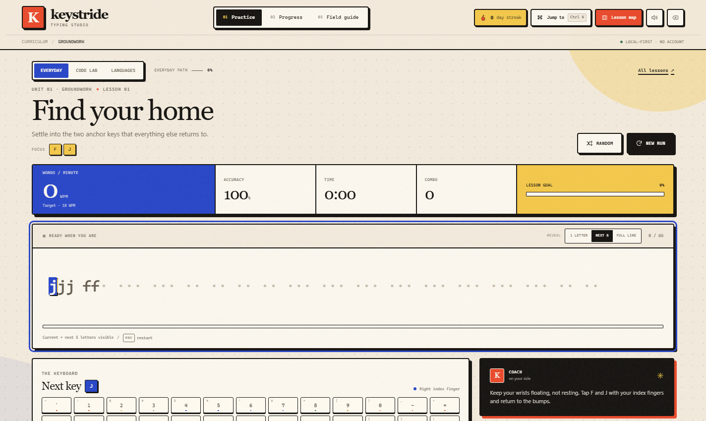
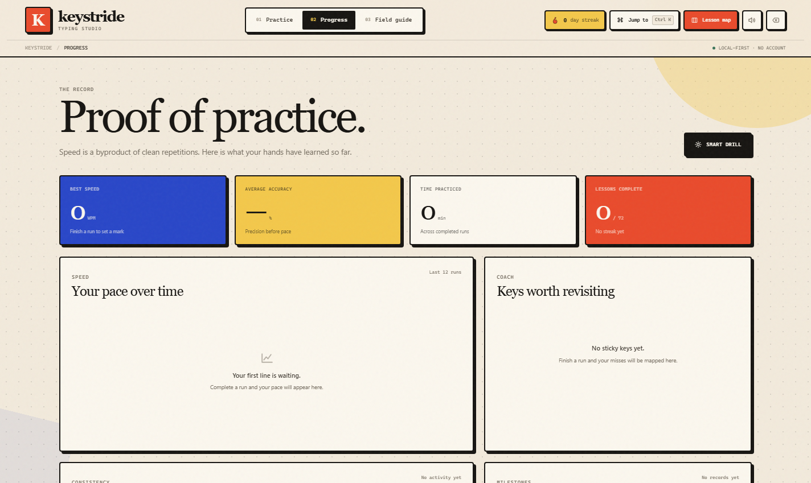

# Keystride

A typing app for everyday text, code, and a few programming languages. Plain HTML, CSS and JavaScript.

## Installation

No build step or dependencies.

1. Clone the repo and enter the folder:

```bash
git clone https://github.com/neverwinter6/keystride.git
cd keystride
```

2. Serve the folder with any static server:

```bash
python -m http.server 8000
```

3. Open [http://localhost:8000](http://localhost:8000).

Opening `index.html` directly works too, but serving the folder keeps the privacy page path correct.

## Screenshots






## Features

- 72 lessons across everyday typing, code, and 12 languages
- a next-five-letters reveal
- an on-screen keyboard with the next key and finger
- optional progress saved in the browser

No accounts, cookies, analytics or third-party requests. Details are in [privacy.html](privacy.html).

MIT.
